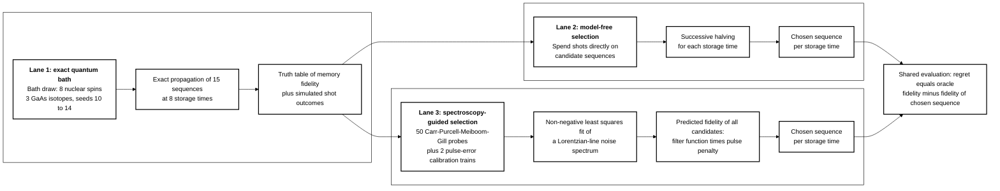
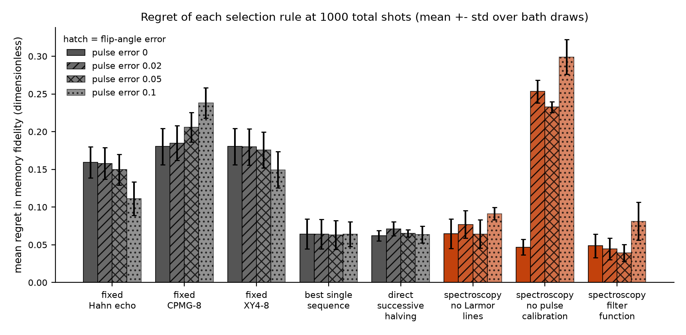
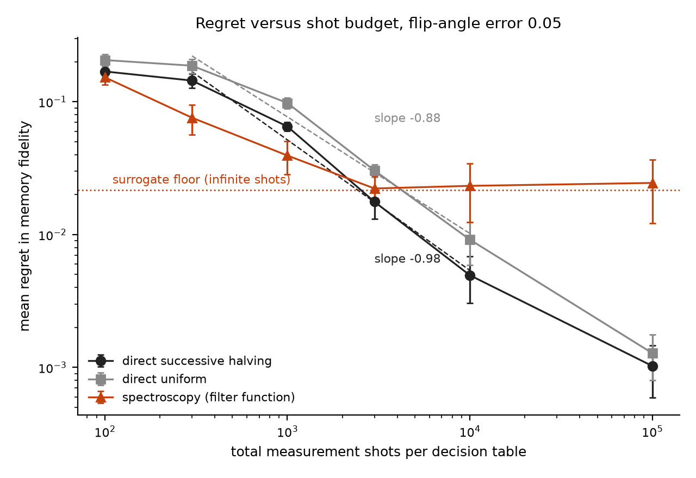
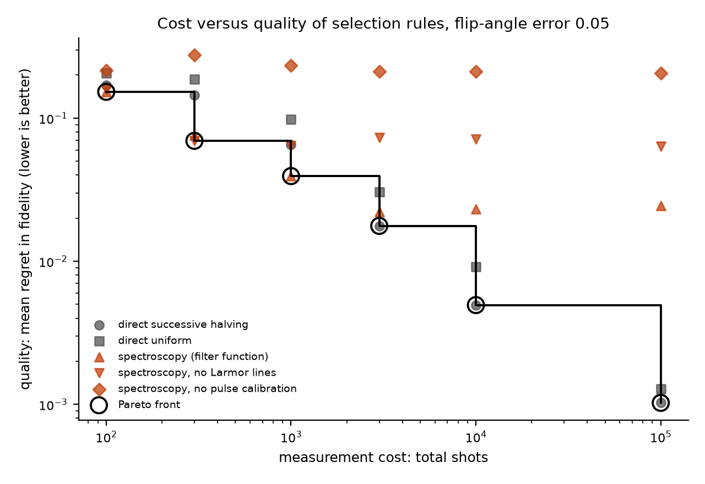
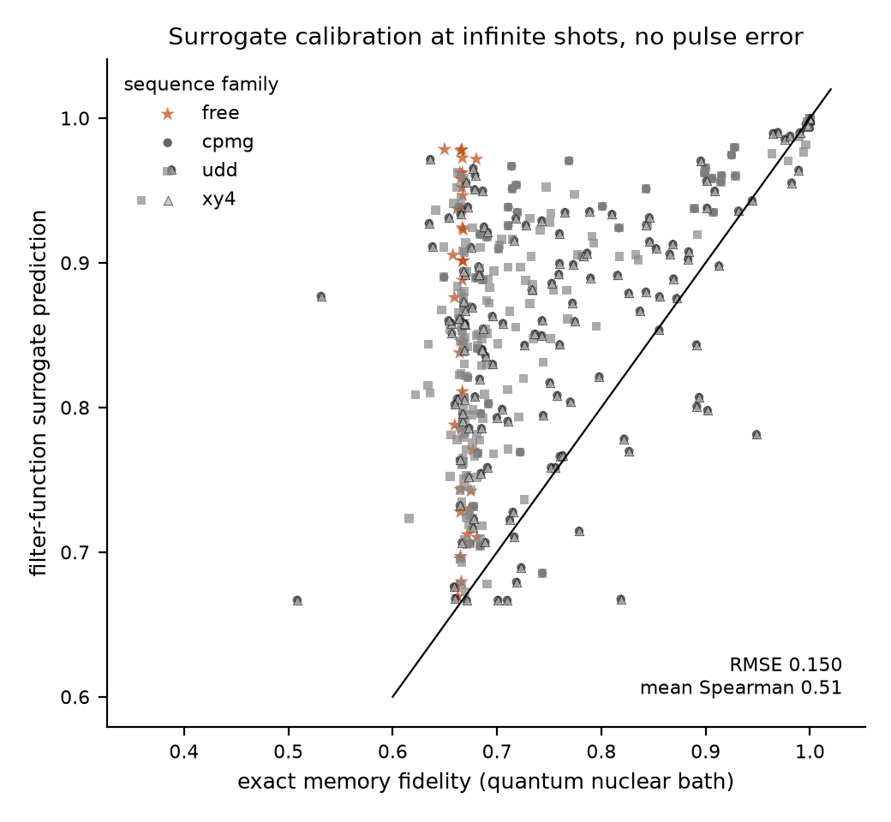
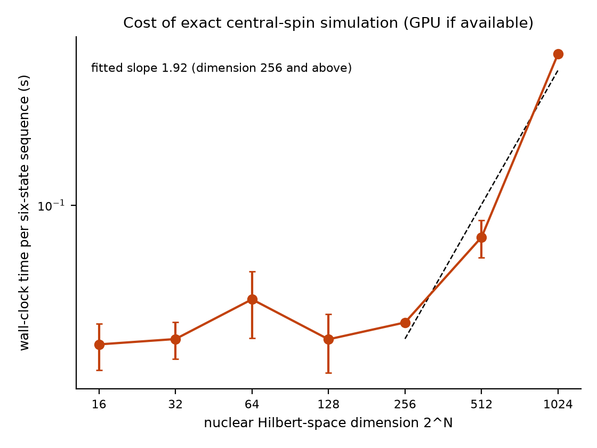

# Spectroscopy-Guided Dynamical-Decoupling Selection for an Electron-Spin Memory in a Nuclear-Spin Bath

[](LICENSE)
[](pyproject.toml)
[](https://github.com/pradeepdegalaroyal/spectroscopy-guided-dd-central-spin-nuclear-bath/actions/workflows/ci.yml)

## Abstract

An electron spin in a gallium arsenide (GaAs) quantum dot (QD) is protected from its nuclear-spin bath by dynamical decoupling (DD), but every candidate pulse sequence and every storage time costs measurement shots to test. This simulation study asks at what total shot budget a classical filter-function noise model, fitted to 50 Carr-Purcell-Meiboom-Gill (CPMG) probe measurements and 2 pulse-error calibration trains, picks better sequences than model-free trial of the same 15 candidates, using an exactly simulated 8-spin quantum bath as ground truth. The surrogate has lower regret than successive halving at 100 to 1,000 shots for flip-angle error 0 and 0.05 (for example 0.039 ± 0.011 versus 0.065 ± 0.005 at 1,000 shots and error 0.05), but it stalls at a model-error floor of about 0.02 to 0.08 in fidelity, so model-free selection wins from 3,000 shots upward, and the surrogate never wins at flip-angle error 0.1. All results are exact statevector simulations; no quantum advantage is claimed.

## Problem statement

A heralded spin-photon quantum network needs the stored electron spin to survive a waiting time that is not fixed in advance. In GaAs QDs the dominant decoherence source is the bath of lattice nuclear spins (hyperfine interaction), and DD sequences can extend the coherence by orders of magnitude. The experimenter must choose, per waiting time, among many sequences (Hahn echo, CPMG, Uhrig dynamical decoupling (UDD), XY4-type four-pulse phase-alternating trains) whose ranking depends on the bath's spectrum and on pulse imperfections, and the only information available is finite-shot measurement data.

## Research gap

The supplied literature frames this problem from neighbouring angles. Degen et al., 2017 (doi:10.1103/RevModPhys.89.035002) establish quantum sensing, with spin qubits as a leading platform, as the experimentalist's tool for characterising environments, and Streltsov et al., 2017 (doi:10.1103/RevModPhys.89.041003) treat coherence as a resource whose evolution must be controlled. Aharonovich et al., 2016 (doi:10.1038/nphoton.2016.186), Wang et al., 2020 (doi:10.1038/s41566-019-0532-1) and Nusyura et al., 2026 (doi:10.1007/s42484-026-00402-8) place QD emitters, integrated photonics and quantum memories at the centre of scalable quantum technology. Yousif et al., 2027 (doi:10.1007/978-3-032-39708-9_27) price device performance in shots per second, and McClean et al., 2016 (doi:10.1088/1367-2630/18/2/023023) show how much a measurement-aware classical loop can save. None of these papers quantifies how many shots are needed to select a decoupling sequence for a given bath, or how far a classical-noise description of a small, strongly coupled quantum bath can be trusted. The full related-work table is in [`docs/RESEARCH_GAP.md`](docs/RESEARCH_GAP.md).

## What is new here

- A shot-budgeted head-to-head of a classical noise-spectroscopy surrogate against model-free selection of DD sequences, scored against exact quantum-bath simulation rather than against the surrogate's own assumptions.
- A measured crossing structure: the budget window in which the surrogate pays off, and the size of its model-error floor for a genuinely quantum bath.
- An ablation showing which ingredient matters: the pulse-error calibration, not the nuclear-resonance spectral lines, dominates the surrogate's quality at non-zero flip-angle error.
- A decision table per storage time (heralding wait), so amortisation of one spectrum over many candidates and waits is part of the cost accounting.

## Hypotheses

Fixed before the final run (the budget grid was chosen from a pilot on bath seeds 0 to 2; the final run uses disjoint seeds 10 to 14).

- **H1.** At 1,000 shots or fewer, the surrogate has lower mean regret than successive halving at every flip-angle error.
- **H2.** With unlimited shots the surrogate keeps a positive regret floor (above 0.01) from classical-model misspecification, whereas model-free selection reaches near-zero regret, so a crossing budget exists below 100,000 shots.
- **H3.** Removing the nuclear-Larmor lines from the spectral basis raises the floor, and removing the pulse-error calibration raises regret when the flip-angle error is 0.05 or more.

## Proposed approach



**Truth model.** An electron spin (S_z = ±1/2) is coupled to N = 8 nuclear spins-1/2 of species 75As, 69Ga and 71Ga (Larmor frequencies set by a 0.1 T field) through parallel and transverse hyperfine couplings, with nuclear flip-flop couplings; the nuclei start maximally mixed and are propagated exactly with instantaneous pulses of angle π(1 + ε). The decision metric is the electron-state fidelity averaged over six cardinal states.

**Candidates and probes.** 15 candidates (free evolution; CPMG and UDD with 2 to 32 pulses; XY4-type trains with 4 to 32 pulses) at 8 storage times from 3 to 50 µs. The surrogate expands the dephasing spectrum in a non-negative Lorentzian basis (continuum plus lines at the three nuclear Larmor frequencies), fits it by non-negative least squares (NNLS) to 50 CPMG probes, multiplies the predicted dephasing fidelity by a per-pulse factor calibrated on a short 16-pulse train, and picks the best candidate for every storage time. Model-free baselines are uniform allocation and successive halving. Fixed Hahn echo, CPMG-8 and XY4-8 and an oracle-fixed "best single sequence" are reported as literature-practice references. Full details are in [`docs/METHOD.md`](docs/METHOD.md).

## Results

Regret is the oracle fidelity minus the fidelity of the selected sequence, averaged over the 8 storage times; values are mean ± standard deviation over 5 bath draws (seeds 10 to 14), each averaged over 30 shot-noise repetitions. Everything below is computed from [`results/regret_all.csv`](results/regret_all.csv) and [`results/summary.json`](results/summary.json); the tables are reproduced in [`results/tables.md`](results/tables.md).

**Table A. Regret versus total shot budget, flip-angle error ε = 0.05.**

| Selection rule | 100 | 300 | 1,000 | 3,000 | 10,000 | 100,000 |
|---|---|---|---|---|---|---|
| direct uniform | 0.206 ± 0.021 | 0.187 ± 0.023 | 0.098 ± 0.009 | 0.030 ± 0.003 | 0.009 ± 0.003 | 0.001 ± 0.000 |
| direct successive halving | 0.169 ± 0.016 | 0.144 ± 0.018 | 0.065 ± 0.005 | 0.018 ± 0.005 | 0.005 ± 0.002 | 0.001 ± 0.000 |
| spectroscopy (filter function) | 0.153 ± 0.018 | 0.076 ± 0.019 | 0.039 ± 0.011 | 0.022 ± 0.005 | 0.023 ± 0.011 | 0.024 ± 0.012 |
| spectroscopy, no Larmor lines | 0.158 ± 0.019 | 0.069 ± 0.023 | 0.064 ± 0.019 | 0.073 ± 0.020 | 0.071 ± 0.019 | 0.063 ± 0.019 |
| spectroscopy, no pulse calibration | 0.215 ± 0.017 | 0.276 ± 0.013 | 0.233 ± 0.007 | 0.212 ± 0.010 | 0.211 ± 0.007 | 0.206 ± 0.018 |

**Table B. Regret at 1,000 shots for each flip-angle error ε.**

| Selection rule | ε = 0 | ε = 0.02 | ε = 0.05 | ε = 0.1 |
|---|---|---|---|---|
| fixed Hahn echo | 0.159 ± 0.021 | 0.158 ± 0.021 | 0.150 ± 0.020 | 0.111 ± 0.022 |
| fixed CPMG-8 | 0.180 ± 0.024 | 0.185 ± 0.023 | 0.206 ± 0.019 | 0.238 ± 0.020 |
| fixed XY4-8 | 0.180 ± 0.024 | 0.180 ± 0.024 | 0.176 ± 0.024 | 0.150 ± 0.024 |
| best single sequence (oracle-fixed) | 0.064 ± 0.020 | 0.064 ± 0.020 | 0.063 ± 0.019 | 0.064 ± 0.017 |
| direct uniform | 0.099 ± 0.009 | 0.105 ± 0.010 | 0.098 ± 0.009 | 0.086 ± 0.011 |
| direct successive halving | 0.062 ± 0.007 | 0.071 ± 0.009 | 0.065 ± 0.005 | 0.064 ± 0.011 |
| spectroscopy (filter function) | 0.049 ± 0.015 | 0.044 ± 0.014 | 0.039 ± 0.011 | 0.081 ± 0.025 |
| spectroscopy, no Larmor lines | 0.065 ± 0.020 | 0.077 ± 0.018 | 0.064 ± 0.019 | 0.091 ± 0.008 |
| spectroscopy, no pulse calibration | 0.047 ± 0.010 | 0.253 ± 0.015 | 0.233 ± 0.007 | 0.299 ± 0.023 |

**Table C. Model-error floor (unlimited probe shots) versus model-free selection at 100,000 shots.**

| Selection rule | ε = 0 | ε = 0.02 | ε = 0.05 | ε = 0.1 |
|---|---|---|---|---|
| spectroscopy (infinite shots) | 0.043 ± 0.042 | 0.026 ± 0.019 | 0.022 ± 0.013 | 0.077 ± 0.064 |
| spectroscopy, no Larmor lines (infinite shots) | 0.064 ± 0.020 | 0.064 ± 0.020 | 0.063 ± 0.019 | 0.134 ± 0.017 |
| direct successive halving, 100,000 shots | 0.000 ± 0.000 | 0.001 ± 0.000 | 0.001 ± 0.000 | 0.001 ± 0.001 |

**Table D. Does the surrogate have lower mean regret than successive halving?**

| Budget | ε = 0 | ε = 0.02 | ε = 0.05 | ε = 0.1 |
|---|---|---|---|---|
| 100 | yes | no | yes | no |
| 300 | yes | no | yes | no |
| 1,000 | yes | yes | yes | no |
| 3,000 | no | no | no | no |
| 10,000 | no | no | no | no |
| 100,000 | no | no | no | no |

In fidelity terms (ε = 0.05, 1,000 shots) the oracle reaches 0.902 ± 0.022, the surrogate 0.863 ± 0.015, successive halving 0.837 ± 0.020, the best single fixed sequence 0.839 ± 0.014 and the fixed Hahn echo 0.753 ± 0.014.



*Figure 1. At 1,000 shots the surrogate is best for ε up to 0.05; dropping the pulse-error calibration makes it worse than a fixed Hahn echo, and ε = 0.1 breaks it.*



*Figure 2. Model-free regret falls with fitted slopes of −0.98 (successive halving) and −0.88 (uniform) between 300 and 10,000 shots on a double-logarithmic scale, while the surrogate flattens at its floor.*



*Figure 3. The Pareto front consists of surrogate points at 100 to 1,000 shots (the full model at 100 and 1,000, the no-Larmor-lines ablation at 300) and of successive-halving points from 3,000 shots upward.*



*Figure 4. With unlimited shots and no pulse error the surrogate has an RMSE (root-mean-square error) of 0.150 and a mean Spearman rank correlation of 0.51 against exact fidelities, and it overpredicts wherever the exact quantum bath dephases or flips the spin.*



*Figure 5. Exact simulation cost per six-state sequence is launch-limited below dimension 256 and scales with fitted slope 1.92 from dimension 256 to 1,024 (three points) on a graphics processing unit (GPU).*

**Bath-size check** ([`results/size_scaling_regret.csv`](results/size_scaling_regret.csv); N = 4 and 6 use seeds 10 to 12, N = 8 uses seeds 10 to 14, ε = 0.05). The surrogate's unlimited-shot floor is 0.118 ± 0.065 (N = 4), 0.068 ± 0.065 (N = 6) and 0.022 ± 0.013 (N = 8), whereas successive halving at 3,000 shots is flat at 0.016 ± 0.002, 0.015 ± 0.002 and 0.018 ± 0.005.

### Outcome against the hypotheses

- **H1 is only partly supported.** The surrogate beats successive halving at 100, 300 and 1,000 shots for ε = 0 and 0.05; for ε = 0.02 it wins only at 1,000 shots (0.044 ± 0.014 versus 0.071 ± 0.009), and for ε = 0.1 it never wins. H1 as stated (every ε) is rejected.
- **H2 is supported.** Floors are 0.043, 0.026, 0.022 and 0.077 (all above 0.01) while successive halving reaches 0.001 or less at 100,000 shots; the surrogate loses at 3,000 shots and above for every ε.
- **H3 is supported.** Without Larmor lines the floor rises from 0.043 to 0.064 (ε = 0), 0.026 to 0.064, 0.022 to 0.063 and 0.077 to 0.134. Without calibration the regret at ε = 0.05 is 0.233 ± 0.007 versus 0.039 ± 0.011 with it (and 0.253 versus 0.044 already at ε = 0.02); at ε = 0 calibration makes no difference (0.047 versus 0.049).

## Discussion

**Where the surrogate pays off.** The probe cost is fixed (52 measurements) whereas direct trial must cover 15 candidates times 8 storage times = 120 cells, so at 100 to 1,000 shots the model amortises one spectrum over every candidate and wait. In that window it cuts regret relative to successive halving from 0.065 to 0.039 at ε = 0.05 and to 0.049 from 0.062 at ε = 0. The gain is modest in absolute fidelity (about 0.026 at ε = 0.05) and sits within roughly two standard deviations at the edges of the window, so it should be read as a regime statement rather than a large effect.

**Why it stalls.** The exact bath is quantum: the surrogate's predicted fidelity is poorly calibrated (RMSE 0.150, Spearman 0.51; Figure 4), because narrow nuclear-resonance collapses of the quantum bath are not captured by a classical Gaussian spectrum fitted at a few probe times. Its ranking is good enough to pick a decent sequence but not the best one, hence the floor of 0.02 to 0.08. Model-free regret instead decays with a slope close to −1 in shots, which is what a successive-halving bandit with a finite gap should do.

**Negative and mixed results.** The surrogate does not win at ε = 0.1, where coherent over-rotation accumulates across pulses and the single-factor per-pulse penalty is a bad model; there even the oracle-fixed best single sequence (0.064 ± 0.017) and successive halving (0.064 ± 0.011) beat it (0.081 ± 0.025). The non-monotone behaviour with ε (a loss at ε = 0.02 for 100 and 300 shots but wins at ε = 0 and 0.05) comes from the five-draw spread: the standard deviations at those cells (up to 0.045) are of the order of the differences. The Larmor lines help the floor but not at the lowest budgets (at ε = 0.05 and 300 shots, 0.069 ± 0.023 without lines versus 0.076 ± 0.019 with), where there are too few shots to constrain the extra basis functions. The oracle's choices also move with ε: it prefers CPMG or UDD at ε = 0 (37 of 40 storage-time cells) and an XY4-type train in 39 of 40 cells at ε = 0.05, which is why fixed CPMG-8 gets worse as ε grows.

**Practical reading.** Standard fixed sequences are poor (regret 0.11 to 0.24 at 1,000 shots), so choosing per waiting time matters. If only about a thousand shots can be spent on characterisation and flip-angle error is small, a spectral model is the better investment; with several thousand shots, or a poorly calibrated pulse, direct halving is. A hybrid (surrogate to prune candidates, halving to finish) is suggested by these curves but was not tested.

## Limitations

- Exact simulation of only 8 nuclear spins-1/2; each stands in for a group of nuclei, couplings are effective values chosen to give sub-microsecond free dephasing and visible nuclear-resonance structure, and real GaAs nuclei are spin 3/2 with quadrupolar effects. The model is not fitted to any device.
- Instantaneous pulses, unpolarised (maximally mixed) nuclei, a single 0.1 T field, no electron relaxation, ideal initialisation and binomial readout, and a systematic (same-sign) flip-angle error.
- The surrogate is given the nuclear Larmor frequencies (known field) and a hand-designed basis, probe grid and calibration train; other choices could move the crossing budget.
- Five bath draws; several differences are within two standard deviations. The bath-size check uses three seeds for N = 4 and 6 and shows a trend (floor shrinking with N) with large spread, not a fitted law.
- Budgets are counted as total shots per decision table; probe or switching overheads and drift during a long characterisation are ignored.

## Future work

- Add finite pulse duration, spin-3/2 nuclei with quadrupolar terms and nuclear polarisation, and fit couplings to a measured echo-decay curve of a real GaAs QD spin.
- Test the hybrid selector (surrogate pruning followed by successive halving) and Bayesian sequential choice of the next probe, which should lower the effective floor and the crossing budget.
- Replace the single-factor pulse penalty with a calibrated pulse-error model, since this is the component that limits the method at ε = 0.1.
- On hardware, the same protocol maps to an arbitrary-waveform-generator-driven spin node: the 52 probes are one automated measurement batch, and the decision table can be refreshed whenever the heralding-wait distribution of the network changes. Extending the bath to electron plus nuclear-register control would connect it to nuclear-spin memory operation.

## Reproducibility

Hardware used for the reported run: Windows 11, Python 3.11.9, 16 CPU threads (6 used), NVIDIA RTX 5050 Laptop graphics processing unit (8 GB; the simulation uses well under 5 GB). Software: numpy 2.2.6, scipy 1.17.1, pandas 2.3.3, matplotlib 3.11.1, torch 2.11.0 (`requirements.txt`).

```bash
pip install -r requirements.txt
pip install -e .
pytest -q                              # 11 tests, about 10 s
python experiments/run_all.py --quick  # smoke run, about 20 s, writes results_quick/ and figures_quick/
python experiments/run_all.py          # full study, 503 s on the machine above
```

The full run writes `results/` (regret_all.csv, truth_fidelity.csv, surrogate_predictions.csv, size_scaling_time.csv, size_scaling_regret.csv, summary.json, win_map.csv, tables.md) and `figures/` (five figures at 200 dpi). Seeds are fixed (bath draws 10 to 14); continuous-integration runs use a CPU-only torch and the `--quick` configuration.

## Project structure

```
src/ddselect/
  bath.py            central-spin Hamiltonian, isotopes, coupling draws
  sequences.py       CPMG, UDD, XY4 and free-evolution sequence definitions
  simulate.py        exact statevector propagation, memory fidelity, probe coherence
  filterfunction.py  switching-function Fourier transform, Lorentzian basis, NNLS surrogate
  study.py           truth tables, simulated shots, selection rules, regret
  report.py          markdown tables and win map from summary.json
  plotting.py        figures (hatched bars, Pareto scatter, double-logarithmic fits)
experiments/run_all.py   one-command reproduction (--quick for a smoke run)
tests/test_ddselect.py   unit tests of sequences, simulation limits, surrogate, selectors
docs/RESEARCH_GAP.md, docs/METHOD.md
results/, figures/
```

## Related work by the author

- [herald-aware-dynamical-decoupling-spin-memory](https://github.com/pradeepdegalaroyal/herald-aware-dynamical-decoupling-spin-memory): dynamical decoupling of a spin memory whose release time is random, under an exact Gaussian dephasing model. The present study instead fixes the storage time, uses a quantum nuclear bath and asks how many shots are needed to choose the sequence.
- [low-rank-drift-twin-sentinel-recalibration](https://github.com/pradeepdegalaroyal/low-rank-drift-twin-sentinel-recalibration): measurement-cost-aware recalibration with a low-rank model, the same model-versus-direct-measurement trade-off in a different setting.

## Citation

```bibtex
@software{chenchupradeep2026ddselect,
  author  = {Degala Chenchupradeep},
  title   = {Spectroscopy-Guided Dynamical-Decoupling Selection for an Electron-Spin Memory in a Nuclear-Spin Bath},
  year    = {2026},
  version = {0.1.0},
  url     = {https://github.com/pradeepdegalaroyal/spectroscopy-guided-dd-central-spin-nuclear-bath},
  license = {MIT}
}
```

MIT license (`LICENSE`). Citation metadata is also provided in `CITATION.cff`.
